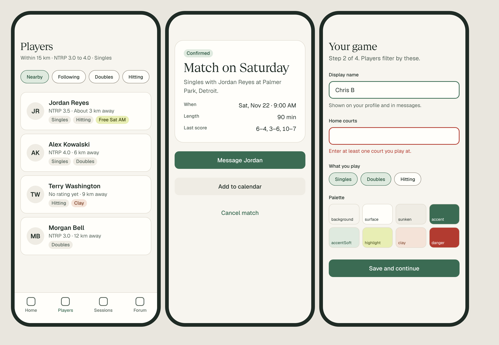

# Love All design

How the Love All app looks, reads and behaves. Agents: read this before you build or change a screen in `apps/mobile`, and build from the pieces in `apps/mobile/src/design` (import from `@/design`). When this doc and the code disagree, the tokens in `apps/mobile/src/design/tokens.ts` win, and you fix the doc in the same change.

## What we're making

Love All helps adult tennis players in the Detroit metro find someone at their level, set up a match or a hitting session, and talk about the game. People open it in short bursts: between work and the courts, in a parking lot, after a set. So every screen answers one question fast ("Who can I play with this week?", "When and where is Saturday's match?") and gets out of the way.

The feel is a quiet public court on a weekday morning: chalk lines, green hard court, a fresh can of balls. Light, calm and plain, never loud or gamified.

## Principles

1. **One job a screen.** Each screen has one main action, styled as the only primary button on it. Everything else is secondary or quiet.
2. **Facts first.** Lead with what a player decides on: name, level, distance, day and time, court. No mood copy, no filler headlines.
3. **Calm by default.** The interface is 90% neutral (chalk grounds, green-grey ink). Colour marks state and the main action, and nothing else.
4. **Thumb-sized and readable.** Every tap target is at least 44pt, body text is 16pt, and nothing is smaller than 13pt.
5. **People are real.** Show real names, photos and levels. Never fake activity, counts, reviews or urgency.
6. **Safe to use.** Blocking, reporting and leaving are always easy to find and never hidden behind a gesture alone. Location is approximate, and the copy says so.

## Building blocks

Everything lives in `apps/mobile/src/design`:

| File                | What it holds                                                                                             |
| ------------------- | --------------------------------------------------------------------------------------------------------- |
| `tokens.ts`         | Colour roles (light and dark), font families, the type scale, spacing, radii, sizes, motion and elevation |
| `tokens.test.ts`    | Checks every text and fill pair meets WCAG AA. Add a row when you add a colour role                       |
| `fonts.ts`          | `useAppFonts()`, which loads Geist Sans and Geist Serif. Already called in the root layout                |
| `use-tokens.ts`     | `useColors()`: the palette for the current colour scheme                                                  |
| `ui/text.tsx`       | `Text`, with `variant`, `color` and `tabular`                                                             |
| `ui/button.tsx`     | `Button`: primary, secondary, quiet and danger, regular and small                                         |
| `ui/card.tsx`       | `Card`: the one card, optionally pressable                                                                |
| `ui/chip.tsx`       | `Chip` (a toggle) and `Tag` (a read-only label)                                                           |
| `ui/text-field.tsx` | `TextField`, with a visible label, hint and error                                                         |
| `ui/screen.tsx`     | `Screen`: safe area, chalk ground, gutters, a serif title and room for the keyboard                       |
| `ui/avatar.tsx`     | `Avatar`: a round photo, or initials on `surfaceSunken`                                                   |
| `ui/icon.tsx`       | `Icon`: an SF Symbol on iOS and the matching Material symbol on Android and web                           |
| `ui/choice-row.tsx` | `ChoiceRow`: a pick-one row with a title and a hint (an NTRP level, a report reason)                      |
| `ui/divider.tsx`    | `Divider`: a hairline with a word in the middle ("or")                                                    |
| `ui/states.tsx`     | `Loading`, `EmptyState` (also used for errors) and `ErrorBanner`                                          |

Rules for using them:

- Import from `@/design`. Don't reach for raw hex values, font names, or numbers for spacing and radius in screen code. If a value you need isn't a token, add the token (and its contrast row) rather than hard-coding it.
- Use `Text` for all text. Don't set `fontFamily` or `fontWeight` on it: pick a `variant`. Android can't choose a weight from one font family, so each weight is its own family in `fontFamily`.
- New shared components go in `src/design/ui/` when two or more features need them. A component only one feature uses lives in that feature's `components.tsx`.
- Every screen is built from `@/design`. The Expo starter styling (`constants/theme.ts`, `ThemedText`, `ThemedView`, `auth-ui.tsx`) is gone: don't bring it back.

## Colour

Light first. The app follows the system setting (`userInterfaceStyle: automatic`), so every role has a dark value too, but design and review in light.

| Role                          | Light                         | Use it for                                                             |
| ----------------------------- | ----------------------------- | ---------------------------------------------------------------------- |
| `background`                  | `#F7F5EF` chalk               | The screen behind everything                                           |
| `surface`                     | `#FFFEFA`                     | Cards, sheets, rows, inputs                                            |
| `surfaceSunken`               | `#EFECE4`                     | Secondary buttons, empty avatars, a quiet block inside a card          |
| `surfacePressed`              | `#E7E3D9`                     | The pressed state of a row, card or secondary button                   |
| `border`                      | `#DDD8CC`                     | Hairlines between rows and around cards (decorative only)              |
| `borderStrong`                | `#8A8478`                     | Input outlines and unselected chips: anything a player must see to use |
| `text`                        | `#1F2B25`                     | Body text and headings                                                 |
| `textMuted`                   | `#55635A`                     | Meta lines, helper text, placeholders, timestamps                      |
| `accent` / `onAccent`         | `#3B6B53` court green / white | The primary button, links, focus, the selected state                   |
| `accentSoft` / `onAccentSoft` | `#DFEADF` / `#24503A`         | A selected chip, a confirmed badge                                     |
| `highlight` / `onHighlight`   | `#E8EEB4` ball / `#454C17`    | "Open spot", "New" and similar tags. A fill only, never text colour    |
| `clay` / `onClay`             | `#F4E3D8` / `#7A3D22`         | Clay court tags, a pending state. A fill only                          |
| `danger` / `onDanger`         | `#B23B30` / white             | Block, report, delete, errors                                          |
| `dangerSoft` / `onDangerSoft` | `#F7E1DD` / `#8A2A21`         | An error banner, a "Blocked" tag                                       |
| `scrim`                       | ink at 32%                    | Behind sheets and dialogs                                              |

How to use colour:

- **Green is the one accent.** One filled green button a screen. Links and selected states are green too, so don't use green for decoration.
- **Ball and clay are tints, not brand colours.** They're for small tags that carry meaning (an open spot, a clay court, a pending invite). Never a whole card, a ground or a big button.
- **Pair every fill with its `on*` colour.** The contrast test only covers pairs it knows about.
- **Never** pure black or pure white grounds, gradients, violet or purple anywhere, or colour as the only signal (a pending invite says "Pending" as well as being clay).
- Photos bring the rest of the colour. Let player photos be the most colourful thing on a list.

## Type

Geist Sans for the interface, Geist Serif for the top of the hierarchy. Both are bundled in `apps/mobile/assets/fonts` under the SIL Open Font License. Geist Serif has one weight, which is fine: it's for display only.

| Variant      | Face          | Size / line | Use                                                                           |
| ------------ | ------------- | ----------- | ----------------------------------------------------------------------------- |
| `display`    | Serif         | 34 / 40     | One a screen at most: a welcome, "Match confirmed", an empty state's headline |
| `title`      | Serif         | 28 / 34     | The screen title                                                              |
| `heading`    | Sans SemiBold | 20 / 26     | A section within a screen ("Availability")                                    |
| `subheading` | Sans SemiBold | 17 / 24     | Card and row titles: a name, a day and time                                   |
| `body`       | Sans Regular  | 16 / 24     | Bios, posts, messages, descriptions                                           |
| `bodyStrong` | Sans Medium   | 16 / 24     | Button labels, values in a list                                               |
| `caption`    | Sans Regular  | 14 / 20     | Meta lines: level, distance, time ago                                         |
| `label`      | Sans Medium   | 13 / 18     | Field labels, chips, tags, small buttons                                      |

- Sentence case everywhere: titles, buttons, tabs, labels. Never all caps or tracked small caps.
- Emphasis comes from weight and size, not colour. Muted text is for secondary information only.
- Scores, times, counts and NTRP levels use `tabular` so they line up in lists ("6–4, 3–6, 10–7").
- Let text wrap. Truncate with `numberOfLines` only in list rows (names, one-line meta), never in body text, buttons or errors. Respect the system font size: never set `allowFontScaling={false}`.

## Space and layout

- Spacing comes from `space` (4, 8, 12, 16, 20, 24, 32, 40, 48, 64). The usual picks: 16 for screen edges and card padding, 8 or 12 inside a group, 24 or 32 between groups.
- Screens use `Screen`, which sets 16pt gutters, the safe area, and a 640pt maximum content width for tablets and web.
- One column on phones. Stack things vertically, with labels above values.
- Lists of people, sessions or threads are flat rows or cards with 8 to 12pt between them. Use a `FlatList` for anything that can grow.
- Put the main action where the thumb is: at the end of a form's content, or pinned above the bottom safe area for a long form or a detail screen (Invite, Send, Save).

## Shape and depth

- Radii: `md` 12 for buttons and inputs, `lg` 16 for cards, `xl` 24 for sheet tops, `full` for chips, tags and avatars. Use `borderCurve: "continuous"` on rounded boxes.
- Flat by default: a card is a `surface` with a `border` hairline. No shadows on cards. `elevation.floating` is only for things over content (a sheet, a toast).
- One card style, never nested. Inside a card, group with space or a `sunken` block.

## Motion

- Presses answer right away: filled buttons and cards scale to 0.98 and darken a step; quiet buttons and chips dim to 0.7.
- Durations: 90ms for a press, 150ms for a small change, 220ms for a panel or sheet, 320ms for a rare screen moment (a match confirmed).
- Use the platform's own transitions for navigation (Expo Router stacks, native tabs, form sheets). Don't build custom ones.
- Nothing loops, bounces, pulses or moves on its own. No confetti. No skeletons that shimmer: a quiet `surfaceSunken` block is enough.
- When the system has Reduce Motion on (`useReducedMotion` from Reanimated, or `AccessibilityInfo`), replace movement with a fade or an instant change.

## Icons and images

- Icons: SF Symbols through `expo-symbols` on iOS, with a matching Material symbol on Android and web. Outline style, 20 or 24pt, in `text` or `textMuted`, or `accent` when it's the selected state. Every icon-only button gets an `accessibilityLabel`.

### Tab bar

The tab bar uses `NativeTabs` from `expo-router/native-tabs`, so iOS and Android draw their own bars. Every tab has an icon and a one-word label. Give each `NativeTabs.Trigger.Icon` an `sf` symbol for iOS (outline by default, filled when selected) and an `md` Material symbol for Android. Don't use PNG tab icons. The bar's ground is `surface`, the selected icon and label are `accent`, and unselected ones are `textMuted`.

| Tab                        | Label    | iOS (`sf`: default / selected)                                       | Android (`md`)   |
| -------------------------- | -------- | -------------------------------------------------------------------- | ---------------- |
| Home                       | Home     | `house` / `house.fill`                                               | `home`           |
| Players                    | Players  | `person.2` / `person.2.fill`                                         | `group`          |
| Play (matches and hitting) | Play     | `calendar` / `calendar`                                              | `calendar_month` |
| Forum                      | Forum    | `bubble.left.and.bubble.right` / `bubble.left.and.bubble.right.fill` | `forum`          |
| Messages                   | Messages | `envelope` / `envelope.fill`                                         | `mail`           |

Five tabs at most. Today's app has Home, Players and Play (`src/components/app-tabs.tsx`, with a matching bar for web in `app-tabs.web.tsx`). Add the others as their features land, rather than as empty tabs.

- Player photos are round (`size.avatar`: 32 in dense lists, 48 in rows, 72 to 112 on a profile). Without a photo, show initials on `surfaceSunken`, as `PlayerAvatar` does.
- No stock photos, illustrations of tennis players, or mascots. Empty states use type, not pictures.
- The app icon and splash still need a design pass (they're the Expo defaults). Use `background` for the splash ground when they're made.

## Components and when to use them

**Button.** `primary` for the one main action, `secondary` for others next to it, `quiet` for low-key text actions (Skip, Edit, Cancel), `danger` for block, report and delete. Labels are a verb and an object in 1 to 4 words: "Send invite", "Save profile", "Block player". Full width in forms and at the bottom of a screen; `size="small"` inside rows and cards. Show `loading` while the request runs, and don't disable the button just because a form is incomplete: let the press show which field needs work.

**TextField.** The label is always visible above the input. A `hint` helps before anything goes wrong. An `error` replaces the hint, names the field and says what to type ("Enter a display name of 2 to 40 characters"). Validate on submit, then live once a field has shown an error. Set `autoComplete`, `textContentType` and the right `keyboardType`.

**Chip and Tag.** `Chip` is a toggle in filters and pick-several lists (levels, formats, days). `Tag` is read-only: `neutral` for facts (Singles, NTRP 3.5), `accent` for confirmed, `highlight` for an open spot or something new, `clay` for clay courts or pending, `danger` for blocked or cancelled. Two or three tags on a row at most.

**Card.** Groups one thing: a player, a session, a thread. Pressable when the whole card opens something, with an `accessibilityLabel` that reads the important facts.

**Screen.** Every full screen. Pass `title` when there's no native header. Tabs screens skip the bottom safe-area edge, because the tab bar handles it.

**Lists.** A row shows the avatar, the name (`subheading`), one or two `caption` meta lines, and at most one trailing action. Pull to refresh on any list that changes.

**Sheets and dialogs.** Use a form sheet (`presentation: "formSheet"` in the Stack) for short tasks such as filters, report reasons or a quick reply. Use a native `Alert` only to confirm something that can't be undone ("Block Sam? They won't be able to find you or message you."), with the destructive button named for the action, not "OK".

## States every screen needs

- **Loading.** Keep the layout steady. Show a centred `ActivityIndicator` in `textMuted` on first load, and never a blank screen. On refresh, keep the old content up.
- **Empty.** Say what's missing and offer the next step: a `display` or `heading` line, one `body` line, and one button. "No players within 10 mi yet" / "Try a wider distance or a different level." / "Widen the search".
- **Error.** Say what failed in plain words and offer a retry: "Couldn't load players. Check your connection and try again." / "Try again". Never show a raw error, status code or stack.
- **Offline.** Keep what's already loaded and show a quiet banner. Queue nothing silently.
- **Success.** Confirm in place (a toast or the button's label changing to "Invite sent") rather than with a dialog. Save big moments, like a confirmed match, for `display`.

## Voice and copy

Write like a friendly club member pinning a note on the board: plain, specific and short.

- Say what it is and what happens. "3 players near you play at 3.5" rather than "Discover your tennis community".
- Headings name a thing ("Upcoming matches", "Your availability"). No questions as headings, no puns, no exclamation marks.
- Buttons are a verb and an object. Never "OK", "Submit", "Learn more", "Click here" or "Continue" when something more specific fits.
- Use the player's words: match, hitting session, singles, doubles, NTRP, court. Write levels as "NTRP 3.5", times as "Sat, Nov 22 · 9:00 AM", and durations as "90 min".
- Errors name the field and the fix. Confirmations name what happened ("Invite sent to Sam"). Never blame the player.
- Location copy is honest about precision: "About 3 mi away", never an address or an exact pin for another player.
- Don't write filler or hype: seamless, effortless, elevate, unlock, journey, community-powered, game-changing, "Ready to…?". Don't invent proof: no fake counts, ratings, reviews or "12 players viewing".
- Use second person ("your profile") and plain contractions. Use "they" for other players unless they've said otherwise.

## Tennis details

- **Level.** NTRP only, shown as "NTRP 3.5" in a `neutral` tag or caption. A player with no rating shows "No rating yet", never a guess.
- **Formats.** Singles, doubles and hitting, shown as tags in that order.
- **Scores.** Set by set with an en dash and tabular figures: "6–4, 3–6, 10–7". A tiebreak goes in brackets: "7–6 (5)".
- **Courts.** Free text plus a map pin. Show the court's name, then the area ("Palmer Park, Detroit").
- **Distance.** Miles, since v1 is US only. Show whole miles with "mi": "About 1 mi away" for anything up to 1 mile (home points are rounded to about 1 km, so nothing finer is honest), then "3 mi away". Search radius choices are in miles too ("Within 10 mi"). The API and database stay metric (`radiusKm`, `distanceKm`): convert in the app at the edge, in one shared helper, and never show km to players.

## Accessibility

- Every interactive element has an `accessibilityRole` and a label, and pressable cards read their important facts. The design components do this. Check it when you build your own.
- Tap targets are at least 44 by 44pt. Use `hitSlop` to pad small controls (the small button and chip already do).
- Contrast is AA at least, and the token test enforces it. Body text on grounds is 7:1 or better.
- Text scales with the system setting. Test the largest accessibility size on your screen: nothing overlaps or gets cut off.
- Don't rely on colour alone. Pair state colour with a word or an icon.
- Focus order follows reading order. Forms move to the next field on Return (`returnKeyType="next"`).

## Checklist before you finish a screen

- [ ] Built with `@/design`: no raw hex values, font names or spacing numbers in screen code.
- [ ] One primary button, with a verb-and-object label.
- [ ] Loading, empty and error states exist and read well.
- [ ] Works in light and dark, at the largest text size, and on a small phone (375pt wide).
- [ ] Every control is 44pt or larger and has an accessible name.
- [ ] The copy follows Voice and copy: no filler, no exclamation marks, errors that say how to fix them.
- [ ] `vp check`, `pnpm typecheck` and `vp test run` pass.

## Where this came from

This system was drafted with the third-party [Taste Skill](https://github.com/Leonxlnx/taste-skill) (`design-taste-frontend`, v2.5.1) as a reference. That skill is built for marketing websites (HTML pages, photos, scroll effects and a browser-based checker), so it isn't installed in this repo and its page rules don't apply here. What we kept from it: one strict system (one accent, one card, one button family, one radius scale), near-neutral interfaces with a warm ink, AA contrast with 7:1 body text, sentence case with nothing under 13pt, short press feedback with no looping motion, and its copy rules (plain, category-first words, verb-and-object buttons, errors that name the field, no filler words or invented proof).
